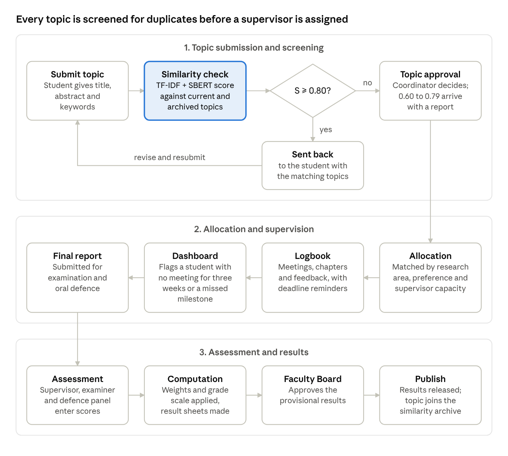

# Final Year Project Proposal

Date: 13 November 2026

| Item | Detail |
| --- | --- |
| Name | Khalil Lawan Ahmed |
| Matric number | MIU/23/CMP/SEN/378 |
| Level | Final year |
| Department | Software Engineering |
| Faculty | Faculty of Computing |
| Institution | Mewar International University, Nigeria |
| Submitted to | Project Coordinator Unit, Faculty of Computing |

## 1. Title of the Project

**Design and Implementation of a Web-Based Final Year Project Coordination System with Topic Similarity Detection, Supervision Tracking and Result Management (A Case Study of the Faculty of Computing, Mewar International University, Nigeria)**

Proposed system name: **MIU ProjectHub**. It is one web application for the Project Coordinator Unit, supervisors, examiners and final-year students of the Faculty of Computing.

## 2. Background of the Study

The final year project is a compulsory part of every computing degree in Nigeria. The National Universities Commission requires each undergraduate to carry out an individual, supervised project as part of the Core Curriculum and Minimum Academic Standards (National Universities Commission \[NUC\], 2023). The project is where students apply what they have learnt to a real problem, and it is often the work they show employers first (Todd et al., 2004).

Behind every project is a chain of administrative work. The Project Coordinator Unit must collect topic proposals, check that each topic is original, approve topics, allocate supervisors, monitor progress, collect scores from supervisors and examiners, and publish results. In many Nigerian faculties these tasks are handled with paper forms, spreadsheets, e-mail and WhatsApp groups. This works for a small class but breaks down as enrolment grows and as more programmes share one coordinator.

The most visible weakness is duplicate topics. A topic submitted this session may repeat one completed three sessions earlier, with only a few words changed. Checking by memory or by scanning old lists is slow and unreliable, and it weakens academic integrity, a concern already documented among Nigerian students (Orim et al., 2013). Supervision is a second weakness: research shows that the quality and regularity of supervisor contact affects final grades and student satisfaction (de Kleijn et al., 2012), yet meetings and feedback are rarely recorded in a form the coordinator can see.

Advances in text similarity now make automatic topic checking practical. Classic term weighting with cosine similarity (Salton & Buckley, 1988) catches topics that share wording, while sentence embedding models such as Sentence-BERT (Reimers & Gurevych, 2019) catch topics that mean the same thing in different words. Combined with a modern web framework, these techniques allow a faculty to run one affordable system for the whole project cycle. The Project Coordinator Unit of the Faculty of Computing at Mewar International University has asked for such a system, and this project proposes to build it.

## 3. Statement of the Problem

The Faculty of Computing coordinates final year projects by hand, so duplicate topics slip through, supervision goes unrecorded, and results are slow and error prone. This study will first confirm and measure each problem with evidence, then solve each one with a specific part of the system.

### 3.1 Problems Identified

| No. | Problem | How it shows up today | Effect |
| --- | --- | --- | --- |
| P1 | Duplicate topics go undetected | New topics are checked against old lists by memory, so reworded copies pass | Repeated work and weakened academic integrity |
| P2 | Topic approval and supervisor allocation are slow and uneven | Students wait weeks for a decision; allocation does not always match research area; some supervisors carry far more students than others | Lost project time, mismatched supervision and overworked supervisors |
| P3 | Supervision is not recorded | There is no record of meetings, chapter submissions or feedback | Stalled students are found too late, and attendance disputes cannot be settled with evidence |
| P4 | Result processing is manual | Scores from supervisors, examiners and the defence panel are copied and added by hand in separate spreadsheets | Calculation errors and delayed results |
| P5 | Project records are scattered | Past topics, reports and scores are not kept in one searchable archive | Duplicate checks are impossible, and accreditation evidence is hard to gather |

### 3.2 Root Cause

All five problems share one root cause: there is no shared digital record of the project cycle. Information lives in paper forms, personal spreadsheets and chat groups, so nobody can search it, check it automatically or see it in one place.

### 3.3 From Problem to Solution

| Problem | Solution in MIU ProjectHub | Objective |
| --- | --- | --- |
| P1 Duplicate topics | A similarity check compares every new topic with current and archived topics and returns or flags close matches before approval | 2 |
| P2 Slow, uneven allocation | An online approval workflow with status tracking, and automatic allocation by research area, student preference and supervisor capacity | 3 |
| P3 Unrecorded supervision | A digital logbook, milestone reminders and a dashboard that flags stalled students | 4 |
| P4 Manual results | Online score entry with automatic weighting, grading and result sheets | 5 |
| P5 Scattered records | One searchable archive of topics, reports and scores, which also feeds the similarity check | 2 and 5 |

## 4. Research Questions

The study will answer the following questions:

1. What are the main problems in the current project coordination process, and how large are they in time lost, duplicate topics and result errors?
2. How can a newly submitted project topic be compared automatically with current and past topics to detect duplicates and near duplicates accurately?
3. How can final year students be allocated to supervisors fairly, based on research area, student preference and supervisor workload?
4. How can supervisor and student engagement (meetings, chapter submissions and feedback) be recorded and monitored so that students at risk are identified early?
5. How can project scores from several assessors be collected, computed and published accurately and securely?
6. To what extent does the developed system solve the identified problems when compared with the current process, and how well do the coordinator, supervisors and students accept it?

## 5. Aim and Objectives of the Study

**Aim:** To solve the problems of undetected duplicate topics, slow and uneven supervisor allocation, unrecorded supervision and manual result processing in the Faculty of Computing, Mewar International University, by designing and implementing a web-based project coordination system.

**Objectives:** The specific objectives are to:

1. Identify and measure the problems in the current project coordination process, find their root cause, and gather requirements from the coordinator, supervisors and students.
2. Design a topic submission module that compares each new topic (title, abstract and keywords) with current and archived topics, and flags any topic whose similarity score passes a set threshold.
3. Develop a supervisor allocation module that matches students to supervisors by research area and student preference, without exceeding each supervisor's maximum load.
4. Develop a supervision logbook that records meetings, chapter submissions, feedback and milestone deadlines, with notifications and a progress dashboard for the coordinator.
5. Develop a result module that collects scores from supervisors, examiners and the defence panel, applies the Faculty's weighting and grade scale, and produces result sheets.
6. Evaluate the system against the baseline measured in objective 1 to confirm that each problem is solved, and test its accuracy, usability and user acceptance.

## 6. Significance of the Study

The system will save time, reduce errors and protect academic integrity for everyone involved in final year projects:

| Beneficiary | How the study helps |
| --- | --- |
| Project Coordinator Unit | One dashboard for all topics, allocations, progress and results. Less paperwork, faster approvals and a full audit trail of every decision. |
| Supervisors | A clear list of assigned students, a simple logbook for meetings and feedback, online grading, and a fairer share of supervision load. |
| Students | Quick feedback on whether a topic is original, a transparent record of supervision, timely reminders, and faster release of results. |
| Faculty and University management | A searchable archive of past projects, reliable data for quality assurance and accreditation, and stronger protection against duplicated work. |
| Researchers and other institutions | A documented design that other faculties, departments or postgraduate schools can adapt, and a reference for future studies on academic workflow systems. |

## 7. Scope and Limitations of the Study

### 7.1 Scope

The study covers undergraduate final year projects in the Faculty of Computing, Mewar International University. The system will have five user roles: administrator, project coordinator, supervisor, examiner and student. It will include the following modules:

- **User and role management:** accounts, login, profiles and role-based access.
- **Topic submission and similarity detection:** submission of title, abstract and keywords, automatic comparison with current and archived topics, and a similarity report for the coordinator.
- **Topic approval workflow:** approve, reject or return a topic for revision, with comments.
- **Supervisor allocation:** allocation by research area, student preference and supervisor capacity, with manual override by the coordinator.
- **Supervision logbook and milestones:** meeting records, chapter uploads, feedback, deadlines, reminders and a progress dashboard.
- **Assessment and result processing:** score entry by each assessor, automatic weighting and grading, result sheets and export to PDF and Excel.
- **Archive and reports:** a searchable record of past projects and summary reports for the Faculty.

The system will be web-based and responsive, so it can be used on laptops and mobile phones.

### 7.2 Limitations

- The similarity check compares topics and abstracts, not full project reports. It does not replace full-text plagiarism tools such as Turnitin.
- Detection accuracy depends on how complete the archive is. Past topics that exist only on paper must first be typed in or imported.
- The system will support English text only.
- It needs an internet connection, so power and network outages may limit access at times.
- Integration with the University's central student portal is outside the scope. Student and staff lists will be imported from CSV files.
- Results produced by the system remain provisional until approved by the Faculty Board and Senate, in line with University regulations.
- Evaluation will use a limited sample of users in one faculty, within one academic session.

## 8. Literature Review

The literature shows that each part of project coordination has a proven technique, but no single affordable system joins them for a Nigerian faculty. This review covers four areas: project supervision, text similarity, supervisor allocation and existing systems.

### 8.1 Final Year Projects and Supervision

Students value the final year dissertation for the knowledge and skills it builds, but they need clear guidance well before the work starts (Todd et al., 2004). In a survey of 401 students, de Kleijn et al. (2012) found that a warm, supportive supervisor relationship was linked to higher grades, more learning and greater satisfaction. Roberts and Seaman (2018) interviewed supervisors and dissertation coordinators and found that good supervision depends on clear, directed advice. They also found that heavy supervisor workloads and mismatched expectations were common causes of poor experiences. These findings support two features of the proposed system: a fair allocation of supervision load, and a shared record of meetings and feedback that sets expectations for both sides.

### 8.2 Text Similarity and Duplicate Topic Detection

Duplicate detection is closely related to plagiarism detection. Surveys of the field group methods into lexical, syntactic and semantic approaches (Alzahrani et al., 2012; Foltýnek et al., 2019).

- **Fingerprinting methods** split text into overlapping word sequences and compare the sets. Broder (1997) measured document resemblance with shingles, and Schleimer et al. (2003) introduced winnowing, which is used in the MOSS code similarity service. These methods are fast but miss reworded text.
- **Vector space methods** represent each document as a vector of weighted terms. Term frequency and inverse document frequency (TF-IDF) weighting with cosine similarity is a standard, well-tested approach (Salton & Buckley, 1988; Manning et al., 2008). It works well for short texts such as titles and abstracts, but treats synonyms as different words.
- **Semantic methods** use learnt word or sentence representations. Word embeddings (Mikolov et al., 2013) and transformer models such as BERT (Devlin et al., 2019) capture meaning. Sentence-BERT produces sentence embeddings that can be compared with cosine similarity quickly enough for real-time use (Reimers & Gurevych, 2019).

Foltýnek et al. (2019) report that semantic methods detect paraphrased text that lexical methods miss. Potthast et al. (2010) proposed evaluating detection systems with precision and recall on labelled cases. This study therefore combines a lexical score (TF-IDF) with a semantic score (Sentence-BERT) and evaluates the result with precision, recall and F1.

### 8.3 Student and Supervisor Allocation

Allocating students to supervisors is a matching problem. Gale and Shapley (1962) introduced stable matching, where no student and supervisor would both prefer each other over their assigned partners. Abraham et al. (2007) extended this to the Student-Project Allocation problem, where students rank projects, and supervisors offer projects and have capacity limits. They gave efficient algorithms that produce stable allocations. Manlove (2013) surveys these and related matching algorithms. This study adapts the student-oriented algorithm of Abraham et al. (2007) so that students rank research areas, supervisors declare areas and maximum loads, and the coordinator can override the result.

### 8.4 Technology Acceptance

A system succeeds only if people use it. The Technology Acceptance Model holds that perceived usefulness and perceived ease of use drive adoption (Davis, 1989). The Unified Theory of Acceptance and Use of Technology adds social influence and facilitating conditions (Venkatesh et al., 2003). This study uses a TAM-based questionnaire, together with the System Usability Scale (Brooke, 1996), to evaluate the finished system.

### 8.5 Review of Existing Approaches

| Approach | What it does | Gap for this study |
| --- | --- | --- |
| Manual process (paper forms, spreadsheets, e-mail, WhatsApp) | Collects topics, allocations and scores by hand | No automatic duplicate check, no tracking, error-prone results, no archive |
| Full-text plagiarism checkers (for example, Turnitin) | Compares finished documents with web pages, publications and stored student papers | Checks reports after the work is written, not topics at proposal stage; does not check against the Faculty's own past topics by default; licence cost; no allocation or grading workflow |
| Learning management systems (for example, Moodle) | Manages courses, assignments and grades (Dougiamas & Taylor, 2003) | Not designed around topic approval, supervisor allocation, supervision logs or multi-assessor project grading |
| Student-Project Allocation algorithms | Produce fair, stable allocations under capacity limits (Abraham et al., 2007) | Research algorithms, not a complete system with submission, tracking and results |
| **Proposed MIU ProjectHub** | Joins topic similarity checking, allocation, supervision tracking and result processing in one system | Addresses the gaps above for the Faculty of Computing |

### 8.6 Research Gap

Existing work treats similarity detection, allocation and supervision as separate problems. Commercial tools check documents after they are written, and general learning platforms do not model the project workflow. There is no low-cost, integrated system that checks topics at proposal stage against a faculty's own archive, allocates supervisors fairly, records supervision, and processes results. This study fills that gap for the Faculty of Computing, Mewar International University.

## 9. Research Methodology

The study will follow the Design Science Research Methodology, which is built around identifying a real problem and solving it with a working system (Hevner et al., 2004; Peffers et al., 2007). Its six activities map to this project as follows:

1. **Identify and measure the problem:** confirm the problems in Section 3 with interviews, questionnaires and records, find the root cause, and record baseline figures.
2. **Define the objectives of a solution:** turn each confirmed problem into system requirements (Section 5).
3. **Design and develop:** build MIU ProjectHub in Agile sprints.
4. **Demonstrate:** run the system with the coordinator, supervisors and students on real topics from past sessions.
5. **Evaluate:** measure the same figures again and compare them with the baseline.
6. **Communicate:** report the findings in the final project report and defence.

### 9.1 Development Model

The system will be built with the Agile Scrum model in two-week sprints (Schwaber & Sutherland, 2020). Each sprint delivers a working module that the Project Coordinator reviews before the next sprint starts. Agile suits this project because requirements will become clearer as the coordinator and supervisors see working features (Sommerville, 2016; Pressman & Maxim, 2020).

### 9.2 Problem Identification and Data Collection

Before any code is written, each problem in Section 3 will be confirmed with evidence and measured, so the finished system can be judged against real figures.

- **Interviews** with the Project Coordinator and at least five supervisors, on the current process, approval rules, allocation practice and scoring scheme.
- **Questionnaires** for about 30 to 50 final year students, on their experience of topic approval, supervision and result release.
- **Document review** of past topic lists, supervision forms and score sheets.
- **Root cause analysis** with a cause and effect (fishbone) diagram built from the interview and questionnaire findings (Ishikawa, 1986).
- **Past topic archive:** titles and abstracts from previous sessions will be digitised. This measures how many duplicates already exist and seeds the similarity engine.

The following baseline figures will be recorded from the current process:

| Problem | Baseline measure | Source |
| --- | --- | --- |
| P1 Duplicate topics | Number of duplicate or near-duplicate topic pairs in the last three sessions | Past topic lists |
| P2 Slow approval | Average days from topic submission to approval and supervisor allocation | Coordinator records and student questionnaire |
| P2 Uneven load | Highest and lowest number of students per supervisor | Allocation lists |
| P3 Unrecorded supervision | Share of students with a written record of supervision meetings | Supervision forms and student questionnaire |
| P4 Result errors and delay | Corrections made to result sheets, and days from defence to result release | Score sheets and coordinator records |

### 9.3 System Analysis and Design

Requirements will be modelled with UML use case, activity, sequence and class diagrams. The database will be designed with an entity relationship diagram and normalised to third normal form (Elmasri & Navathe, 2016). User interfaces will be prototyped in Figma and reviewed with the coordinator before coding.

### 9.4 Topic Similarity Detection Method

Each submitted topic (title, abstract and keywords) is cleaned by lowercasing, removing punctuation and stop words, and lemmatising. It is then compared with every current and archived topic in two ways.

First, a lexical score uses TF-IDF weighting, where the weight of term t in document d is:

$$
w_{t,d} = tf_{t,d} \times \log \frac{N}{df_t}
$$

Here tf is the number of times t appears in d, N is the number of topics in the archive, and df is the number of topics that contain t. Two topics A and B are compared with cosine similarity:

$$
\text{sim}(A,B) = \frac{\sum_{i=1}^{n} A_i B_i}{\sqrt{\sum_{i=1}^{n} A_i^2} \, \sqrt{\sum_{i=1}^{n} B_i^2}}
$$

Second, a semantic score applies the same cosine formula to Sentence-BERT embeddings (the all-MiniLM-L6-v2 model), so that topics with the same meaning in different words are caught. The final score combines both:

$$
S = \alpha \, S_{\text{TF-IDF}} + (1 - \alpha) \, S_{\text{SBERT}}, \quad 0 \le \alpha \le 1
$$

The weight α and the thresholds below will be tuned on a labelled test set:

| Combined score S | Status | Action |
| --- | --- | --- |
| 0.80 and above | Likely duplicate | Returned to the student with the matching topics shown |
| 0.60 to 0.79 | Similar | Sent to the coordinator for review with a similarity report |
| Below 0.60 | Clear | Forwarded for normal approval |

### 9.5 Supervisor Allocation Method

Students rank their preferred research areas, and supervisors declare their areas of expertise and maximum number of students. The system adapts the student-oriented Student-Project Allocation algorithm (Abraham et al., 2007) to produce an allocation that respects every supervisor's capacity and gives students their highest available preference. The coordinator reviews the proposed allocation and can override any assignment, with the reason recorded.

### 9.6 Supervision Tracking and Result Processing

Each student has a digital logbook. Students upload chapters, and supervisors record meetings and feedback with dates. Milestones (proposal, chapters one to five, final report, defence) have deadlines, and the system sends reminders. The coordinator's dashboard flags any student with no recorded meeting for three weeks or a missed milestone.

For results, each assessor enters scores against a rubric. The system applies the Faculty's weighting (for example, supervisor 40%, internal examiner 30%, oral defence 30%), computes the total, assigns a grade from the University's approved grade scale, and produces result sheets. Weights and grade bands are configurable. Results stay provisional until the coordinator submits them for Faculty Board approval.

### 9.7 Tools and Technologies

| Layer | Tool | Reason for choice |
| --- | --- | --- |
| Frontend | React with Tailwind CSS | Responsive interface for laptops and phones |
| Backend | Python with Django and Django REST Framework | Secure, mature framework in the same language as the NLP libraries |
| Database | PostgreSQL | Reliable relational database with full-text search |
| Similarity engine | scikit-learn, sentence-transformers, spaCy | TF-IDF, Sentence-BERT embeddings and text preprocessing |
| Reports | ReportLab and openpyxl | PDF result sheets and Excel export |
| Notifications | SMTP e-mail and in-app alerts | Reminders and status updates |
| Design | Figma and draw.io | Interface prototypes and UML diagrams |
| Version control | Git and GitHub | Change tracking and backup of source code |
| Testing | pytest and Postman | Unit, integration and API testing |
| Deployment | Linux cloud server with Nginx and HTTPS | Secure online access |

### 9.8 Security and Data Protection

The system will use role-based access control, hashed passwords, HTTPS, audit logs of key actions, and regular database backups. Personal data of students and staff will be handled in line with the Nigeria Data Protection Act 2023 (Federal Republic of Nigeria, 2023).

### 9.9 Testing and Evaluation

| What is evaluated | Method | Target |
| --- | --- | --- |
| Problem solved | The baseline measures in Section 9.2 are taken again with the system in use and compared | Every measure improves on its baseline |
| Functional correctness | Unit, integration, system and user acceptance tests against the requirements | All critical test cases pass |
| Similarity detection | Precision, recall and F1 on labelled topic pairs; TF-IDF alone, SBERT alone and combined are compared (Potthast et al., 2010) | F1 of 0.80 or higher for the combined method |
| Allocation | Check capacity limits and preference satisfaction on test data | No supervisor over capacity; most students get one of their top three areas |
| Result accuracy | Compare system results with manually computed results for a sample | Zero computation errors |
| Usability | System Usability Scale questionnaire (Brooke, 1996) | Score above 68, the common benchmark average (Sauro, 2011) |
| User acceptance | TAM questionnaire on a five-point Likert scale (Davis, 1989) | Mean of 4.0 or higher for usefulness and ease of use |

### 9.10 Proposed System Workflow

A topic scoring 0.80 or more goes back to the student before any supervisor time is spent. Every published project then joins the archive used for later similarity checks.

## 10. Resources Required

The project needs modest hardware, free open-source software, the time of a few staff and students, and an estimated budget of ₦255,200.

### 10.1 Hardware

- Laptop with at least an Intel Core i5 (or equivalent) processor, 8 GB RAM and 256 GB SSD, for development and testing.
- Android smartphone, for testing the mobile layout.
- Internet modem or mobile hotspot.
- Uninterruptible power supply (UPS) or power bank, to protect work during power outages.
- Cloud server (Linux, 2 GB RAM or more), for hosting the system during testing and evaluation.

### 10.2 Software

- Operating system: Windows 10/11 or Ubuntu Linux.
- Code editor: Visual Studio Code.
- Languages and frameworks: Python, Django, Django REST Framework, JavaScript, React and Tailwind CSS.
- Database: PostgreSQL.
- Libraries: scikit-learn, sentence-transformers, spaCy, ReportLab and openpyxl.
- Design and documentation: Figma, draw.io and Microsoft Word.
- Version control and testing: Git, GitHub, pytest and Postman.

All the software above is free or open source, so there is no licence cost.

### 10.3 Human Resources

- The project supervisor, for guidance and review.
- The Project Coordinator and staff of the Project Coordinator Unit, for requirements and feedback.
- At least five supervisors and 30 to 50 final year students, for interviews, questionnaires and user testing.

### 10.4 Estimated Budget

| Item | Estimated cost (₦) |
| --- | --- |
| Internet data (6 months) | 60,000 |
| Cloud hosting (6 months) | 60,000 |
| Generator fuel and power backup | 40,000 |
| Printing and binding of proposal and final report | 35,000 |
| Transport for data collection | 15,000 |
| Domain name (1 year) | 12,000 |
| Printing of questionnaires | 10,000 |
| Contingency (10%) | 23,200 |
| **Total** | **255,200** |

Costs are estimates at current Nigerian prices and will be confirmed with quotes. The laptop and smartphone are already owned by the researcher and are not included.

## 11. Expected Results

At the end of the study, each problem identified in Section 3 is expected to be solved, and shown to be solved against its baseline:

| Problem | Baseline (measured first) | Expected result with MIU ProjectHub |
| --- | --- | --- |
| P1 Duplicate topics | Duplicate pairs found in past sessions | Every new topic checked within seconds of submission; duplicates in the test set caught with an F1 score of 0.80 or higher |
| P2 Slow, uneven allocation | Days to approve and allocate; spread of supervisor loads | Fewer days to approve and allocate; no supervisor over capacity; most students in one of their top three research areas |
| P3 Unrecorded supervision | Share of students with a meeting record | A dated digital logbook for every student; stalled students flagged within three weeks |
| P4 Manual results | Corrections and days to release results | Zero calculation errors; results ready for the Faculty Board sooner after the defence |
| P5 Scattered records | No searchable archive | Any past topic found by keyword in seconds |

Users are also expected to rate the system well: a System Usability Scale score above 68, and a mean of 4.0 or higher for usefulness and ease of use.

Other deliverables will include:

- A problem analysis report with the baseline figures, root cause diagram and requirements specification.
- The deployed web application and its source code.
- A searchable digital archive of past and current project topics.
- A user manual for coordinators, supervisors, examiners and students.
- Technical documentation and the final project report.

## References

Abraham, D. J., Irving, R. W., & Manlove, D. F. (2007). Two algorithms for the Student-Project Allocation problem. *Journal of Discrete Algorithms, 5*(1), 73-90. https://doi.org/10.1016/j.jda.2006.03.006

Alzahrani, S. M., Salim, N., & Abraham, A. (2012). Understanding plagiarism linguistic patterns, textual features, and detection methods. *IEEE Transactions on Systems, Man, and Cybernetics, Part C (Applications and Reviews), 42*(2), 133-149. https://doi.org/10.1109/TSMCC.2011.2134847

Broder, A. Z. (1997). On the resemblance and containment of documents. In *Proceedings of Compression and Complexity of SEQUENCES 1997* (pp. 21-29). IEEE. https://doi.org/10.1109/SEQUEN.1997.666900

Brooke, J. (1996). SUS: A "quick and dirty" usability scale. In P. W. Jordan, B. Thomas, B. A. Weerdmeester, & I. L. McClelland (Eds.), *Usability evaluation in industry* (pp. 189-194). Taylor & Francis.

Davis, F. D. (1989). Perceived usefulness, perceived ease of use, and user acceptance of information technology. *MIS Quarterly, 13*(3), 319-340. https://doi.org/10.2307/249008

de Kleijn, R. A. M., Mainhard, M. T., Meijer, P. C., Pilot, A., & Brekelmans, M. (2012). Master's thesis supervision: Relations between perceptions of the supervisor-student relationship, final grade, perceived supervisor contribution to learning and student satisfaction. *Studies in Higher Education, 37*(8), 925-939. https://doi.org/10.1080/03075079.2011.556717

Devlin, J., Chang, M.-W., Lee, K., & Toutanova, K. (2019). BERT: Pre-training of deep bidirectional transformers for language understanding. In *Proceedings of the 2019 Conference of the North American Chapter of the Association for Computational Linguistics (NAACL-HLT)* (pp. 4171-4186). Association for Computational Linguistics. https://doi.org/10.18653/v1/N19-1423

Dougiamas, M., & Taylor, P. (2003). Moodle: Using learning communities to create an open source course management system. In *Proceedings of EdMedia: World Conference on Educational Multimedia, Hypermedia and Telecommunications 2003*. Association for the Advancement of Computing in Education.

Elmasri, R., & Navathe, S. B. (2016). *Fundamentals of database systems* (7th ed.). Pearson.

Federal Republic of Nigeria. (2023). *Nigeria Data Protection Act, 2023*.

Foltýnek, T., Meuschke, N., & Gipp, B. (2019). Academic plagiarism detection: A systematic literature review. *ACM Computing Surveys, 52*(6), Article 112. https://doi.org/10.1145/3345317

Gale, D., & Shapley, L. S. (1962). College admissions and the stability of marriage. *The American Mathematical Monthly, 69*(1), 9-15. https://doi.org/10.2307/2312726

Hevner, A. R., March, S. T., Park, J., & Ram, S. (2004). Design science in information systems research. *MIS Quarterly, 28*(1), 75-105. https://doi.org/10.2307/25148625

Ishikawa, K. (1986). *Guide to quality control* (2nd rev. ed.). Asian Productivity Organization.

Manlove, D. F. (2013). *Algorithmics of matching under preferences*. World Scientific.

Manning, C. D., Raghavan, P., & Schütze, H. (2008). *Introduction to information retrieval*. Cambridge University Press.

Mikolov, T., Chen, K., Corrado, G., & Dean, J. (2013). *Efficient estimation of word representations in vector space* (arXiv:1301.3781). arXiv. https://doi.org/10.48550/arXiv.1301.3781

National Universities Commission. (2023). *Core curriculum and minimum academic standards for the Nigerian university system: Computing*. National Universities Commission.

Orim, S.-M., Davies, J., Borg, E., & Glendinning, I. (2013). Exploring Nigerian postgraduate students' experience of plagiarism: A phenomenographic case study. *International Journal for Educational Integrity, 9*(1), 20-34. https://doi.org/10.21913/IJEI.v9i1.845

Peffers, K., Tuunanen, T., Rothenberger, M. A., & Chatterjee, S. (2007). A design science research methodology for information systems research. *Journal of Management Information Systems, 24*(3), 45-77. https://doi.org/10.2753/MIS0742-1222240302

Potthast, M., Stein, B., Barrón-Cedeño, A., & Rosso, P. (2010). An evaluation framework for plagiarism detection. In *Proceedings of the 23rd International Conference on Computational Linguistics (COLING 2010): Posters* (pp. 997-1005). Association for Computational Linguistics.

Pressman, R. S., & Maxim, B. R. (2020). *Software engineering: A practitioner's approach* (9th ed.). McGraw-Hill Education.

Reimers, N., & Gurevych, I. (2019). Sentence-BERT: Sentence embeddings using Siamese BERT-networks. In *Proceedings of the 2019 Conference on Empirical Methods in Natural Language Processing and the 9th International Joint Conference on Natural Language Processing (EMNLP-IJCNLP)* (pp. 3982-3992). Association for Computational Linguistics. https://doi.org/10.18653/v1/D19-1410

Roberts, L. D., & Seaman, K. (2018). Good undergraduate dissertation supervision: Perspectives of supervisors and dissertation coordinators. *International Journal for Academic Development, 23*(1), 28-40. https://doi.org/10.1080/1360144X.2017.1412971

Salton, G., & Buckley, C. (1988). Term-weighting approaches in automatic text retrieval. *Information Processing & Management, 24*(5), 513-523. https://doi.org/10.1016/0306-4573(88)90021-0

Sauro, J. (2011). *A practical guide to the System Usability Scale: Background, benchmarks & best practices*. Measuring Usability LLC.

Schleimer, S., Wilkerson, D. S., & Aiken, A. (2003). Winnowing: Local algorithms for document fingerprinting. In *Proceedings of the 2003 ACM SIGMOD International Conference on Management of Data* (pp. 76-85). ACM. https://doi.org/10.1145/872757.872770

Schwaber, K., & Sutherland, J. (2020). *The Scrum guide*. https://scrumguides.org

Sommerville, I. (2016). *Software engineering* (10th ed.). Pearson.

Todd, M., Bannister, P., & Clegg, S. (2004). Independent inquiry and the undergraduate dissertation: Perceptions and experiences of final-year social science students. *Assessment & Evaluation in Higher Education, 29*(3), 335-355.

Venkatesh, V., Morris, M. G., Davis, G. B., & Davis, F. D. (2003). User acceptance of information technology: Toward a unified view. *MIS Quarterly, 27*(3), 425-478. https://doi.org/10.2307/30036540
