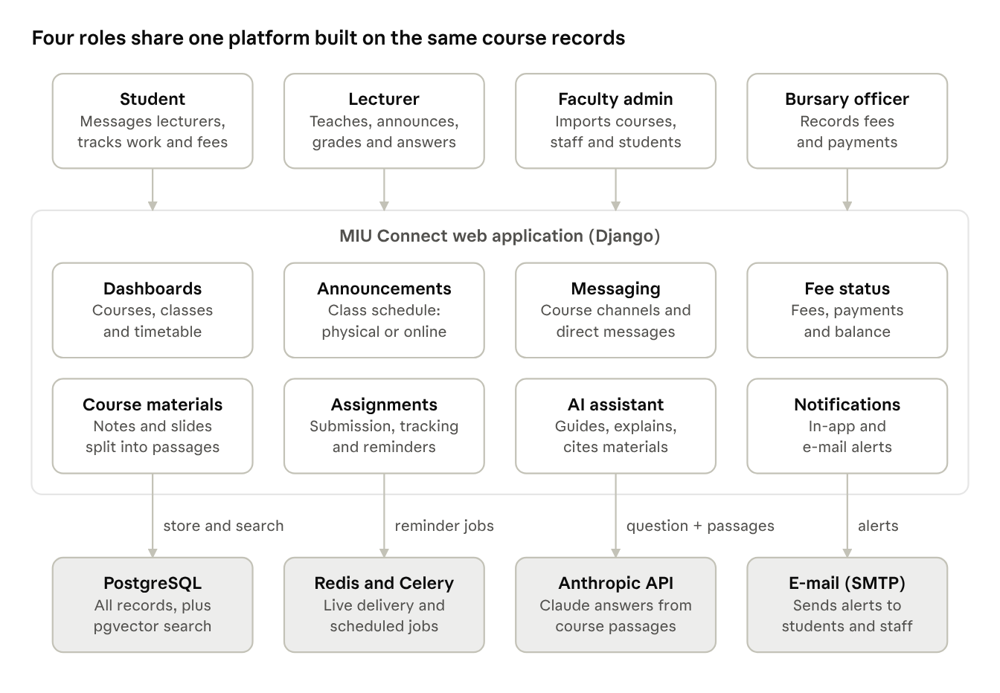

# Final Year Project Proposal

Date: 15 November 2026

| Item | Detail |
| --- | --- |
| Name | Khalil Lawan Ahmed |
| Matric number | MIU/23/CMP/SEN/378 |
| Level | Final year |
| Department | Software Engineering |
| Faculty | Faculty of Computing |
| Institution | Mewar International University, Nigeria |

## 1. Title of the Project

**Design and Implementation of an AI-Assisted Student and Lecturer Communication Platform with Assignment Tracking and Fee Status Monitoring (A Case Study of the Faculty of Computing, Mewar International University, Nigeria)**

Proposed system name: **MIU Connect**. It is one web application where lecturers and students each have their own login. Lecturers see what they teach and reach their classes; students reach their lecturers, track their assignments, get AI study help and see their fee balance.

## 2. Background of the Study

Regular contact between students and lecturers is central to learning. Chickering and Gamson (1987) list student and faculty contact as the first of their seven principles of good practice in undergraduate education. Moore (1989) names learner and instructor interaction as one of the three types of interaction that support learning.

In many Nigerian universities this contact happens informally. Students walk from office to office looking for lecturers, rely on class representatives to pass messages, and follow announcements in WhatsApp groups. WhatsApp is easy, cheap and immediate (Bouhnik & Deshen, 2014), but academic notices get mixed with social chat and buried under new messages. Students who are not in the right group miss them, and lecturers' personal phone numbers end up shared widely.

Other parts of student life are just as scattered. Assignments are given in class or in chat groups with no central record, so deadlines are missed. Students find out their fee balance by visiting the bursary. Lecturers keep their own lists of courses, classes and schedule changes, and must repeat every change to each class.

Two developments now make one integrated platform practical. Workplace messaging tools such as Slack show how channels and direct messages can organise group communication. In a university case study, Slack made it easier for students to ask questions, but the authors recommended a platform designed specifically for education (Tuhkala & Kärkkäinen, 2018). At the same time, large language models can explain concepts and guide students through problems at any hour (Kasneci et al., 2023), provided they are designed to support learning rather than do the work for students (Cotton et al., 2024). This project combines these ideas into MIU Connect, a platform built around the courses, lecturers, students and fees of the Faculty of Computing at Mewar International University.

## 3. Statement of the Problem

Students and lecturers in the Faculty of Computing have no single place to communicate, so messages are missed, deadlines slip and simple questions take days to answer. This study will first confirm and measure each problem with evidence, then solve each one with a specific part of the system.

### 3.1 Problems Identified

| No. | Problem | How it shows up today | Effect |
| --- | --- | --- | --- |
| P1 | Students cannot reach lecturers easily | Students search offices, wait for class representatives, or obtain lecturers' personal phone numbers | Questions go unanswered, time is wasted, and lecturers lose their privacy |
| P2 | Announcements and class changes are missed | Notices go out in WhatsApp groups and on notice boards; changes to time, venue or online and physical mode travel by word of mouth | Students miss classes or turn up for cancelled ones |
| P3 | Assignments and deadlines are not tracked | Assignments are given verbally or in chat, with no reminders and no record of who has submitted | Late or missed submissions and lost marks |
| P4 | Fee status is unclear | Students must visit the bursary to find out what they have paid and what they still owe | Wasted trips and surprises at registration or examination time |
| P5 | Students lack help outside class hours | Lecturers are not available at night or at weekends | Students get stuck, fall behind, or copy answers |
| P6 | Lecturers lack one view of their teaching | Course allocations, class lists and timetables are kept in separate documents | Time lost on administration and errors in schedules |

### 3.2 Root Cause

All six problems share one root cause: there is no single platform that connects students, lecturers, courses and records. Information is spread across WhatsApp groups, notice boards, paper lists and separate offices, so nobody has one reliable source of truth.

### 3.3 From Problem to Solution

| Problem | Solution in MIU Connect | Objective |
| --- | --- | --- |
| P1 Hard to reach lecturers | Direct messages and course channels between students and lecturers, with lecturer office hours shown, and no personal phone numbers exposed | 4 |
| P2 Missed announcements | Course announcements and a class schedule that shows each session as physical (with venue) or online (with link), with instant notifications when anything changes | 3 |
| P3 Untracked assignments | An assignment tracker with online submission, pending and overdue lists, and automatic deadline reminders | 5 |
| P4 Unclear fee status | A fee page showing each student's fees, payments and outstanding balance, kept up to date by bursary staff | 7 |
| P5 No help after hours | An AI study assistant that explains course material and guides students step by step without writing their assignments for them | 6 |
| P6 No teaching overview | A lecturer dashboard showing assigned courses, levels, class lists and timetable; students see the same for their own courses and lecturers | 2 |

## 4. Research Questions

The study will answer the following questions:

1. What are the main communication and information problems faced by students and lecturers in the Faculty of Computing, and how large are they in time lost, missed announcements and late submissions?
2. How can students and lecturers communicate directly and reliably through one platform without exposing personal phone numbers?
3. How can course announcements, class schedules and changes in class mode (physical or online) reach every affected student in time?
4. How can assignments be tracked and deadline reminders be delivered so that fewer submissions are late or missed?
5. How can an AI study assistant help students understand course material while protecting academic integrity?
6. How can students see their fee payments and outstanding balance without visiting the bursary?
7. To what extent does the developed system solve the identified problems when compared with the current situation, and how well do students and lecturers accept it?

## 5. Aim and Objectives of the Study

**Aim:** To solve the problems of poor student and lecturer communication, missed announcements, untracked assignments and unclear fee status in the Faculty of Computing, Mewar International University, by designing and implementing an AI-assisted web platform with separate portals for lecturers and students.

**Objectives:** The specific objectives are to:

1. Identify and measure the communication and information problems faced by students and lecturers, find their root cause, and gather requirements.
2. Develop role-based portals for students, lecturers and administrators, including a lecturer dashboard of assigned courses, levels, class lists and timetable, and a student view of their courses and lecturers.
3. Develop an announcements and class schedule module that marks each class as physical or online and notifies students of any change.
4. Develop a messaging module with course channels and direct messages between students and lecturers.
5. Develop an assignment module for posting, submission, tracking of pending and overdue work, deadline reminders, grading and feedback.
6. Develop an AI study assistant that answers questions from the lecturer's course materials and guides students without completing their assignments for them.
7. Develop a fee status module that shows each student's fees, payments and outstanding balance, maintained by bursary staff.
8. Evaluate the system against the baseline measured in objective 1, and test its usability, user acceptance and the quality and integrity of the AI assistant.

## 6. Significance of the Study

The system will save time, reduce missed information and support learning for everyone in the Faculty:

| Beneficiary | How the study helps |
| --- | --- |
| Students | Reach lecturers without searching for them, never miss an announcement or class change, see every assignment and deadline in one place, get study help at any hour, and know their fee balance without visiting the bursary. |
| Lecturers | One dashboard of courses, classes and timetable; announce to a whole class in one step; collect and grade assignments online; keep their personal phone numbers private. |
| Faculty administration and bursary | Fewer repeated enquiries, one place to publish fee records and course allocations, and a record of communication for quality assurance. |
| University management | Better student engagement and a digital platform that can be extended to other faculties. |
| Researchers | A documented design for an education-specific messaging platform with a guided AI assistant, useful for further studies in Nigerian universities. |

## 7. Scope and Limitations of the Study

### 7.1 Scope

The study covers undergraduate students and lecturers of the Faculty of Computing, Mewar International University. The system will have four user roles: student, lecturer, faculty administrator and bursary officer. It will include the following modules:

- **Accounts and portals:** separate logins and dashboards for each role.
- **Teaching dashboard:** lecturers see their assigned courses, levels, class lists and timetable; students see their courses and who teaches each one.
- **Announcements and class schedule:** course announcements, and class sessions marked physical (with venue) or online (with meeting link), with notifications of changes.
- **Messaging:** a channel for each course and direct messages between students and lecturers, with lecturer office hours shown.
- **Assignments:** posting, file submission, pending and overdue lists, deadline reminders, grading and feedback.
- **Course materials:** lecturers upload notes and slides for each course.
- **AI study assistant:** answers questions using the lecturer's course materials, explains concepts and gives hints, and helps students plan around their deadlines.
- **Fee status:** each student's fee items, payments, receipts and outstanding balance.
- **Notifications:** in-app and e-mail alerts.

The system will be a responsive web application, so it can be used on laptops and mobile phones.

### 7.2 Limitations

- The fee module shows payment records but does not process payments. Students will continue to pay through the University's existing channels, and bursary staff will update records manually or by CSV import.
- Integration with the University's central portal is outside the scope. Student, lecturer and course data will be imported from CSV files.
- The AI assistant depends on an external language model service, so it needs internet access, has a usage cost, and can make mistakes. Its answers will be based on course materials and clearly labelled as AI help; it does not replace the lecturer.
- The assistant is designed to guide rather than write assignments, but the system cannot stop students from using other AI tools.
- Online classes will link to existing video tools such as Google Meet or Zoom; the system will not host video.
- There will be no native Android or iOS app.
- Power and network outages may limit access at times.
- Evaluation will use a limited sample of students and lecturers in one faculty, within one academic session.

## 8. Literature Review

The literature supports each part of the proposed platform, but existing tools solve these problems separately. This review covers student and lecturer interaction, messaging tools in education, deadlines, AI study assistants and existing systems.

### 8.1 Student and Lecturer Interaction

Chickering and Gamson (1987) place frequent student and faculty contact first among their seven principles of good practice, alongside prompt feedback and clear time on task. Moore (1989) describes three types of interaction in education: learner and content, learner and instructor, and learner and learner. A platform that supports learning should make all three easy. In MIU Connect, course materials and the AI assistant support learner and content interaction, direct messages support learner and instructor interaction, and course channels support learner and learner interaction.

### 8.2 Messaging Tools in Education

Teachers already use general messaging apps with their students. Bouhnik and Deshen (2014) studied teachers who used WhatsApp with their classes and found that they valued its ease of use, low cost, availability and immediacy. Tuhkala and Kärkkäinen (2018) replaced e-mail and the learning management system with Slack in a university thesis seminar. Students found it easy to use and felt it lowered the barrier to asking questions. However, they worried about information overload and about using a tool the university did not officially support, and the teacher faced problems with file management and user accounts. The authors suggested that an education-specific alternative to Slack could be more useful. MIU Connect follows this advice: it keeps the channel and direct message model, but ties every channel to a real course, its lecturer and its enrolled students.

### 8.3 Deadlines and Reminders

Steel (2007) reviewed research on procrastination and found it to be common, with people less motivated by tasks whose rewards or deadlines feel far away. This supports two features of the system: a single list of every pending assignment, and reminders that arrive as each deadline approaches.

### 8.4 AI Study Assistants

Computer tutors that respond to each learner have a long record of success. Kulik and Fletcher (2016) reviewed controlled evaluations of intelligent tutoring systems and found that students who used them outperformed students in conventional classes in most studies. Large language models make this kind of help far easier to build. Kasneci et al. (2023) describe their potential for explanations and personalised learning, but warn that they can be wrong or biased and need human oversight. Cotton et al. (2024) add that they create new risks for academic integrity, and recommend clear policies and careful assessment design.

Two design choices respond to these concerns. First, retrieval-augmented generation lets a language model answer from a set of retrieved documents rather than from memory alone, which makes answers more specific and factual (Lewis et al., 2020). MIU Connect will retrieve passages from the lecturer's own course materials and show which material each answer is based on. Second, the assistant will work as a guide: it explains, asks questions and gives hints, but declines to produce complete answers to assignment questions.

### 8.5 Technology Acceptance

The Technology Acceptance Model holds that perceived usefulness and perceived ease of use drive whether people adopt a system (Davis, 1989). The System Usability Scale gives a quick, reliable measure of usability (Brooke, 1996). Both will be used to evaluate MIU Connect.

### 8.6 Review of Existing Approaches

| Approach | What it does | Gap for this study |
| --- | --- | --- |
| WhatsApp class groups | Fast, free group messaging run by class representatives | Academic notices are mixed with social chat and get buried; no assignment tracking; lecturers' numbers are exposed; not tied to official course lists |
| Workplace messaging (Slack, Microsoft Teams) | Channels and direct messages for organisations | Not linked to courses, timetables, assignments or fees; extra setup and accounts (Tuhkala & Kärkkäinen, 2018) |
| Learning management systems (for example, Moodle or Google Classroom) | Course pages, materials and assignments (Dougiamas & Taylor, 2003) | Separate from fee records and class schedules; usually no AI assistant grounded in course materials |
| University student portals | Registration, results and fee payment | Usually no messaging, announcements or assignment tracking |
| General AI chatbots (for example, ChatGPT) | Answer questions on any topic | Not based on the lecturer's materials; will often write full assignments, raising integrity concerns (Cotton et al., 2024) |
| **Proposed MIU Connect** | Joins messaging, announcements, class schedule, assignments, a guided AI assistant and fee status in one platform | Addresses the gaps above for the Faculty of Computing |

### 8.7 Research Gap

Each existing tool solves part of the problem. Students and lecturers therefore move between WhatsApp, notice boards, a portal and the bursary, and the information never comes together. There is no low-cost platform, built around a Nigerian faculty's own courses, lecturers and fee records, that combines direct communication, class scheduling, assignment tracking, fee status and a course-grounded AI assistant that supports learning without doing the work. This study fills that gap.

## 9. Research Methodology

The study will follow the Design Science Research Methodology, which is built around identifying a real problem and solving it with a working system (Hevner et al., 2004; Peffers et al., 2007). Its six activities map to this project as follows:

1. **Identify and measure the problem:** confirm the problems in Section 3 with questionnaires, interviews and records, find the root cause, and record baseline figures.
2. **Define the objectives of a solution:** turn each confirmed problem into system requirements (Section 5).
3. **Design and develop:** build MIU Connect in short Agile sprints.
4. **Demonstrate:** run a pilot with real lecturers and students in selected courses.
5. **Evaluate:** measure the same figures again and compare them with the baseline.
6. **Communicate:** report the findings in the final project report and defence.

### 9.1 Problem Identification and Data Collection

Before any code is written, each problem will be confirmed with evidence and measured.

- **Questionnaire** for about 50 to 100 students across all levels of the Faculty.
- **Interviews** with at least five lecturers, a faculty administrator and a bursary officer.
- **Document review** of course allocation lists, timetables and samples of class announcements.
- **Root cause analysis** with a cause and effect (fishbone) diagram built from the findings (Ishikawa, 1986).

The following baseline figures will be recorded from the current situation:

| Problem | Baseline measure | Source |
| --- | --- | --- |
| P1 Hard to reach lecturers | Average time for a student to get an answer from a lecturer | Student questionnaire |
| P2 Missed announcements | Share of students who missed at least one announcement or class change in the last month | Student questionnaire |
| P3 Untracked assignments | Share of assignments submitted late or not at all in sampled courses | Lecturer records |
| P4 Unclear fee status | Number of bursary visits per student per semester just to check fees | Student questionnaire and bursary interview |
| P5 No help after hours | Share of students who often get stuck on coursework with no one to ask | Student questionnaire |
| P6 No teaching overview | Hours per week lecturers spend on class administration and repeating announcements | Lecturer interviews |

### 9.2 Development Model

The system will be built with the Agile Scrum model in one-week sprints, so a working version exists early and grows each week (Schwaber & Sutherland, 2020; Sommerville, 2016):

| Sprint | Delivers | Problem addressed |
| --- | --- | --- |
| 1 | Logins, roles, data import, lecturer and student dashboards | P6 |
| 2 | Announcements, class schedule with physical or online mode, notifications | P2 |
| 3 | Course channels and direct messages | P1 |
| 4 | Assignments, submission, tracking and deadline reminders | P3 |
| 5 | Course materials and the AI study assistant | P5 |
| 6 | Fee status, final testing and deployment | P4 |

### 9.3 System Analysis and Design

Requirements will be modelled with UML use case, activity, sequence and class diagrams. The database will be designed with an entity relationship diagram and normalised to third normal form (Elmasri & Navathe, 2016). Screens will be prototyped in Figma and reviewed with lecturers and students before coding (Pressman & Maxim, 2020).

### 9.4 Messaging, Announcements and Reminders

Every course gets a channel automatically, with its lecturer and enrolled students as members. Messages are delivered in real time over WebSockets and stored, so nothing is lost when a student is offline. Announcements and class changes create a notification for every enrolled student, in the app and by e-mail. A scheduled background job checks deadlines every hour and reminds each student who has not submitted at 72 hours and 24 hours before the deadline, and again when work becomes overdue.

### 9.5 AI Study Assistant Method

The assistant uses retrieval-augmented generation (Lewis et al., 2020):

1. Lecturers upload notes and slides. The text is extracted and split into short passages.
2. Each passage is turned into a vector with a sentence embedding model (Reimers & Gurevych, 2019) and stored in the database.
3. When a student asks a question in a course, the question is embedded and the most similar passages from that course are retrieved, using cosine similarity:

$$
\text{sim}(q,p) = \frac{q \cdot p}{\lVert q \rVert \, \lVert p \rVert}
$$

4. The question and the retrieved passages are sent to a large language model (Claude, through the Anthropic API) with fixed instructions: explain, ask guiding questions and give hints; name the course material used; and do not produce complete answers to assignment questions.
5. The answer is shown with links to the source materials.

The assistant also knows the assignments posted in the student's courses. If a student pastes an assignment question, it switches to step-by-step guidance. It can also read the student's pending deadlines and suggest a study plan. Only the question, course passages and assignment titles are sent to the AI service; fee records and personal details are not.

### 9.6 Fee Status Method

Bursary staff record each student's fee items for the session and each payment with its receipt number, by hand or by CSV import. The outstanding balance is the total of fee items minus the total of payments. Students see the breakdown, payment history and balance, and can download a statement.

### 9.7 Tools and Technologies

| Layer | Tool | Reason for choice |
| --- | --- | --- |
| Web framework | Python with Django | Secure, mature framework with built-in accounts, admin and roles |
| Interface | Django templates with Tailwind CSS and HTMX | Responsive pages for laptops and phones, with less code than a separate frontend |
| Real-time messaging | Django Channels and Redis | WebSocket delivery of messages and notifications |
| Background jobs | Celery | Deadline reminders and e-mail sending |
| Database | PostgreSQL with pgvector | Relational data plus vector search for the AI assistant |
| AI | Anthropic API (Claude) and sentence-transformers | Language model answers and passage embeddings |
| Design | Figma and draw.io | Screen prototypes and UML diagrams |
| Version control | Git and GitHub | Change tracking and backup |
| Testing | pytest | Automated unit and integration tests |
| Deployment | Linux cloud server with Nginx and HTTPS | Secure online access |

### 9.8 Security and Data Protection

Access will be role based: students see only their own courses, assignments and fees, and lecturers see only the courses they teach. The system will use hashed passwords, HTTPS, audit logs of key actions and regular backups. Personal data will be handled in line with the Nigeria Data Protection Act 2023 (Federal Republic of Nigeria, 2023).

### 9.9 Testing and Evaluation

After a four-week pilot in selected courses, the system will be evaluated as follows:

| What is evaluated | Method | Target |
| --- | --- | --- |
| Problem solved | The baseline measures in Section 9.1 are taken again and compared | Every measure improves on its baseline |
| Functional correctness | Unit, integration, system and user acceptance tests | All critical test cases pass |
| Notification delivery | Post test announcements and class changes to courses | Every enrolled student notified within one minute |
| AI answer quality | Lecturers rate a sample of 50 assistant answers for correctness on a five-point scale | Mean of 4.0 or higher |
| AI integrity | Ask the assistant 30 assignment-style questions that request full answers | At least 90% answered with guidance instead of a full answer |
| Fee accuracy | Compare displayed balances with bursary records for a sample of students | No mismatches |
| Usability | System Usability Scale questionnaire (Brooke, 1996) | Score above 68, the common benchmark average (Sauro, 2011) |
| User acceptance | TAM questionnaire on a five-point Likert scale (Davis, 1989) | Mean of 4.0 or higher for usefulness and ease of use |

### 9.10 System Architecture

Each role logs in to its own portal, but every module reads the same course, enrolment and fee records in one database. Only the AI assistant sends data outside the system, and only the question and course passages.

## 10. Resources Required

The project needs modest hardware, mostly free open-source software, the cooperation of a few staff and students, and an estimated budget of ₦315,700.

### 10.1 Hardware

- Laptop with at least an Intel Core i5 (or equivalent) processor, 8 GB RAM and 256 GB SSD, for development and testing.
- Android smartphone, for testing the mobile layout.
- Internet modem or mobile hotspot.
- Uninterruptible power supply (UPS) or power bank.
- Cloud server (Linux, 4 GB RAM or more), for hosting the system during the pilot.

### 10.2 Software and Services

- Operating system: Windows 10/11 or Ubuntu Linux.
- Code editor: Visual Studio Code.
- Languages and frameworks: Python, Django, Django Channels, Celery, HTMX and Tailwind CSS.
- Database and cache: PostgreSQL with pgvector, and Redis.
- AI: Anthropic API (paid per use) and sentence-transformers (free).
- Design and documentation: Figma, draw.io and Microsoft Word.
- Version control and testing: Git, GitHub and pytest.

All software above is free or open source except the AI service, which is paid per use.

### 10.3 Human Resources

- The project supervisor, for guidance and review.
- At least five lecturers, a faculty administrator and a bursary officer, for interviews, data and the pilot.
- About 50 to 100 students, for the questionnaire, the pilot and the usability survey.

### 10.4 Estimated Budget

| Item | Estimated cost (₦) |
| --- | --- |
| Internet data (6 months) | 60,000 |
| Cloud hosting (6 months) | 60,000 |
| AI service usage during development and pilot | 50,000 |
| Generator fuel and power backup | 40,000 |
| Printing and binding of proposal and final report | 35,000 |
| Printing of questionnaires | 15,000 |
| Transport for data collection | 15,000 |
| Domain name (1 year) | 12,000 |
| Contingency (10%) | 28,700 |
| **Total** | **315,700** |

Costs are estimates at current Nigerian prices and will be confirmed with quotes. The laptop and smartphone are already owned by the researcher and are not included.

## 11. Expected Results

At the end of the study, each problem identified in Section 3 is expected to be solved, and shown to be solved against its baseline:

| Problem | Baseline (measured first) | Expected result with MIU Connect |
| --- | --- | --- |
| P1 Hard to reach lecturers | Time for a student to get an answer from a lecturer | Students message lecturers directly in the app; answers arrive faster than the baseline; no personal numbers shared |
| P2 Missed announcements | Share of students who missed an announcement or class change | Every enrolled student notified of each announcement and class change within one minute; fewer missed classes |
| P3 Untracked assignments | Share of late or missing submissions | Every student sees all pending work with reminders; fewer late or missing submissions than the baseline |
| P4 Unclear fee status | Bursary visits just to check fees | Students see fees, payments and balance online, with no mismatch against bursary records |
| P5 No help after hours | Share of students often stuck with no one to ask | AI help available at any hour, rated 4.0 or higher for correctness by lecturers, with at least 90% of full-answer requests turned into guidance |
| P6 No teaching overview | Lecturer hours spent on class administration | Lecturers see courses, classes and timetable on one dashboard and announce to a class in one step |

Users are also expected to rate the system well: a System Usability Scale score above 68, and a mean of 4.0 or higher for usefulness and ease of use.

Other deliverables will include:

- A problem analysis report with the baseline figures, root cause diagram and requirements specification.
- The deployed web application and its source code.
- A user manual for students, lecturers, administrators and bursary staff.
- Technical documentation and the final project report.

## References

Bouhnik, D., & Deshen, M. (2014). WhatsApp goes to school: Mobile instant messaging between teachers and students. *Journal of Information Technology Education: Research, 13*, 217-231. https://www.jite.org/documents/Vol13/JITEv13ResearchP217-231Bouhnik0601.pdf

Brooke, J. (1996). SUS: A "quick and dirty" usability scale. In P. W. Jordan, B. Thomas, B. A. Weerdmeester, & I. L. McClelland (Eds.), *Usability evaluation in industry* (pp. 189-194). Taylor & Francis.

Chickering, A. W., & Gamson, Z. F. (1987). Seven principles for good practice in undergraduate education. *AAHE Bulletin, 39*(7), 3-7.

Cotton, D. R. E., Cotton, P. A., & Shipway, J. R. (2024). Chatting and cheating: Ensuring academic integrity in the era of ChatGPT. *Innovations in Education and Teaching International, 61*(2), 228-239. https://doi.org/10.1080/14703297.2023.2190148

Davis, F. D. (1989). Perceived usefulness, perceived ease of use, and user acceptance of information technology. *MIS Quarterly, 13*(3), 319-340. https://doi.org/10.2307/249008

Dougiamas, M., & Taylor, P. (2003). Moodle: Using learning communities to create an open source course management system. In *Proceedings of EdMedia: World Conference on Educational Multimedia, Hypermedia and Telecommunications 2003*. Association for the Advancement of Computing in Education.

Elmasri, R., & Navathe, S. B. (2016). *Fundamentals of database systems* (7th ed.). Pearson.

Federal Republic of Nigeria. (2023). *Nigeria Data Protection Act, 2023*.

Hevner, A. R., March, S. T., Park, J., & Ram, S. (2004). Design science in information systems research. *MIS Quarterly, 28*(1), 75-105. https://doi.org/10.2307/25148625

Ishikawa, K. (1986). *Guide to quality control* (2nd rev. ed.). Asian Productivity Organization.

Kasneci, E., Sessler, K., Küchemann, S., Bannert, M., Dementieva, D., Fischer, F., Gasser, U., Groh, G., Günnemann, S., Hüllermeier, E., Krusche, S., Kutyniok, G., Michaeli, T., Nerdel, C., Pfeffer, J., Poquet, O., Sailer, M., Schmidt, A., Seidel, T., ... Kasneci, G. (2023). ChatGPT for good? On opportunities and challenges of large language models for education. *Learning and Individual Differences, 103*, Article 102274. https://doi.org/10.1016/j.lindif.2023.102274

Kulik, J. A., & Fletcher, J. D. (2016). Effectiveness of intelligent tutoring systems: A meta-analytic review. *Review of Educational Research, 86*(1), 42-78. https://doi.org/10.3102/0034654315581420

Lewis, P., Perez, E., Piktus, A., Petroni, F., Karpukhin, V., Goyal, N., Küttler, H., Lewis, M., Yih, W., Rocktäschel, T., Riedel, S., & Kiela, D. (2020). Retrieval-augmented generation for knowledge-intensive NLP tasks. In *Advances in Neural Information Processing Systems 33* (pp. 9459-9474). Curran Associates.

Moore, M. G. (1989). Three types of interaction. *American Journal of Distance Education, 3*(2), 1-7. https://doi.org/10.1080/08923648909526659

Peffers, K., Tuunanen, T., Rothenberger, M. A., & Chatterjee, S. (2007). A design science research methodology for information systems research. *Journal of Management Information Systems, 24*(3), 45-77. https://doi.org/10.2753/MIS0742-1222240302

Pressman, R. S., & Maxim, B. R. (2020). *Software engineering: A practitioner's approach* (9th ed.). McGraw-Hill Education.

Reimers, N., & Gurevych, I. (2019). Sentence-BERT: Sentence embeddings using Siamese BERT-networks. In *Proceedings of the 2019 Conference on Empirical Methods in Natural Language Processing and the 9th International Joint Conference on Natural Language Processing (EMNLP-IJCNLP)* (pp. 3982-3992). Association for Computational Linguistics. https://doi.org/10.18653/v1/D19-1410

Sauro, J. (2011). *A practical guide to the System Usability Scale: Background, benchmarks & best practices*. Measuring Usability LLC.

Schwaber, K., & Sutherland, J. (2020). *The Scrum guide*. https://scrumguides.org

Sommerville, I. (2016). *Software engineering* (10th ed.). Pearson.

Steel, P. (2007). The nature of procrastination: A meta-analytic and theoretical review of quintessential self-regulatory failure. *Psychological Bulletin, 133*(1), 65-94. https://doi.org/10.1037/0033-2909.133.1.65

Tuhkala, A., & Kärkkäinen, T. (2018). Using Slack for computer-mediated communication to support higher education students' peer interactions during Master's thesis seminar. *Education and Information Technologies, 23*(6), 2379-2397. https://doi.org/10.1007/s10639-018-9722-6
